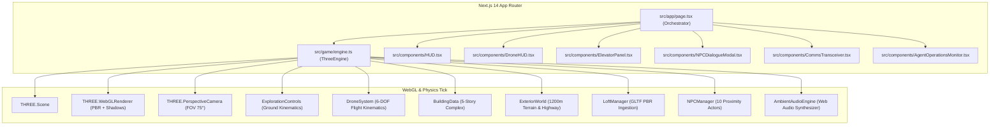
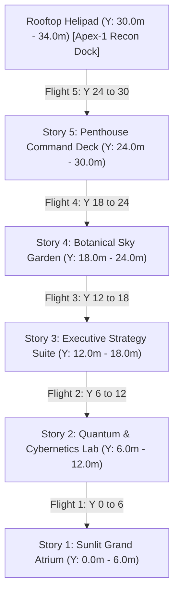
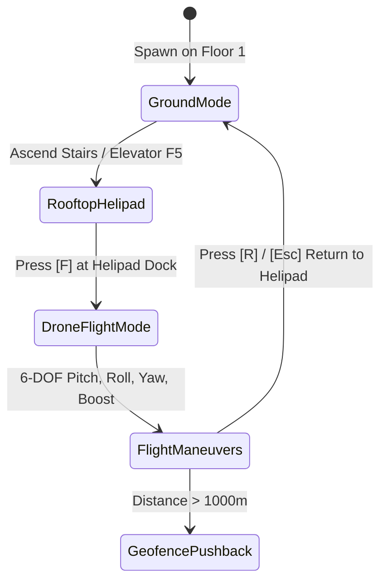
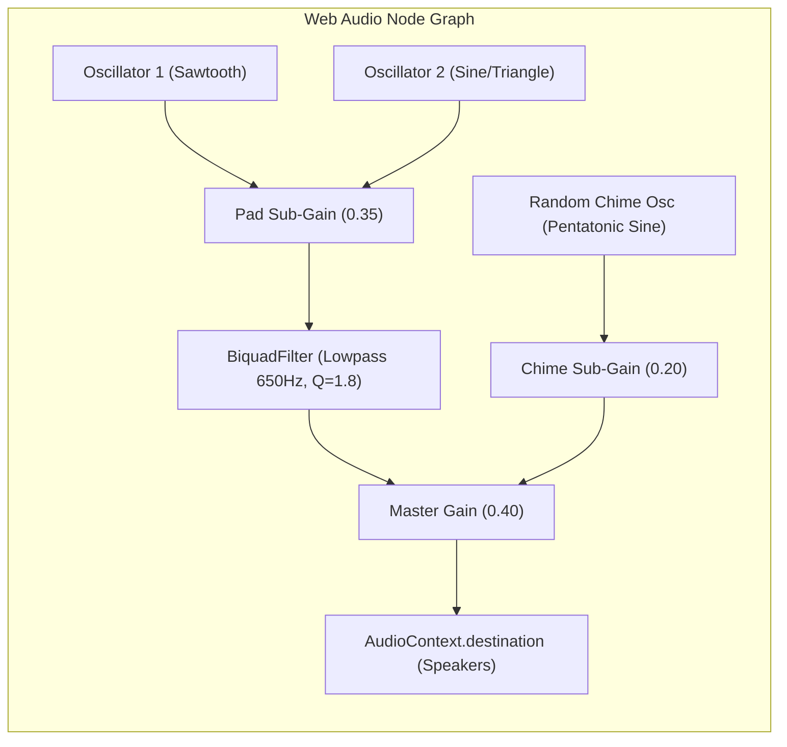
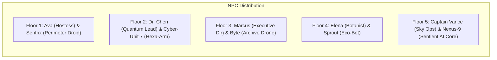

# 🏛️ Apex Nexus Architecture Specification

This document details the architectural, mechanical, mathematical, and rendering design of **The Apex Nexus** (`agents_map`), an interactive real-time 3D exploration and aerial drone reconnaissance system built on **Next.js 14**, **Three.js (r169)**, and **TypeScript**.

The project is the result of an autonomous multi-agent co-engineering workflow:
* **Agent Atlas (World Architect)** — Structural civil engineering, East Wing switchback stairs & slope physics, exterior terrain generation.
* **Agent Neo (Systems & Physics Engineer)** — WebGL render loop, 60 FPS physics tick, 6-DOF drone aerodynamics, and raycasting systems.
* **Agent Iris (3D Interior Designer & Atmosphere)** — Daylight illumination, PBR materiality, staged GLB lofts, soundscape, and resident NPC lore.
* **Agent Scribe (Technical Documentation & DevOps)** — Architecture documentation, gameplay codex, release engineering, and repository deployment.

---

## 🗺️ System Overview & High-Level Architecture

---

## 🏢 1. The 5-Story Complex: Structural Civil Engineering

The building is designed as a contemporary high-concept pavilion measuring $40\text{m} \times 40\text{m}$ in footprint with a total elevation of $34\text{m}$. Each story provides a clear vertical height of $6.0\text{m}$ separated by structural floor slabs ($0.4\text{m}$ reinforced composite concrete).

### Structural Hierarchy & Elevation Grid

| Story | Elevation ($Y$) | Primary Function | Floor Material | Staged Asset / Landmark |
| :--- | :--- | :--- | :--- | :--- |
| **Story 1** | $0.0\text{m} - 6.0\text{m}$ | Sunlit Grand Atrium & Lobby | Calacatta Gold Marble | `loft_16_interior.glb`, Fluted Brass Columns, Reception |
| **Story 2** | $6.0\text{m} - 12.0\text{m}$ | Quantum & Cybernetics Lab | Reflective Optical Epoxy | Cryogenic Quantum Core, Laser Diagnostics, Server Banks |
| **Story 3** | $12.0\text{m} - 18.0\text{m}$ | Executive Strategy & Archives | Honey-Oak Parquet | `free_loft_18.glb` Mezzanine Suite, Brass Boardroom Table |
| **Story 4** | $18.0\text{m} - 24.0\text{m}$ | Botanical Sky Garden | Living Turf & Cedar Deck | `interior_7.glb`, Japanese Maple, Suspended Glass Balcony |
| **Story 5** | $24.0\text{m} - 30.0\text{m}$ | Penthouse Command Deck | Midnight Slate & Brass | `free_loft_18.glb`, Holographic Globe, Command Terminals |
| **Rooftop** | $30.0\text{m} - 34.0\text{m}$ | Helipad & Recon Drone Port | Reinforced Aviation Pad | Apex-1 Drone Dock, Pulsing Helipad Ring, Hazard Strobes |

### East Wing Continuous Switchback Stairwell & Ramp Physics
A major engineering challenge was providing silky-smooth traversal between all 5 floors without physical clipping or step jitter.

* **Shaft Footprint**: $X \in [11.5\text{m}, 18.5\text{m}], Z \in [-6.5\text{m}, +6.5\text{m}]$.
* **Switchback Structure**: Each 6.0m story rise is divided into two 3.0m flights:
  * **Flight 1 (Ascending North $\to$ Center)**: $Z \in [-5.0\text{m}, 0.0\text{m}]$, $\Delta Z = 5.0\text{m}$, $\Delta Y = 3.0\text{m}$, $\theta = \arctan(3/5) \approx 30.96^\circ$.
  * **Mid-Story Rest Landing**: Centered at $(X: 15.0\text{m}, Y: Y_{\text{base}} + 3.0\text{m}, Z: 0.0\text{m})$, platform dimensions $4.6\text{m} \times 2.4\text{m}$.
  * **Flight 2 (Ascending Center $\to$ South)**: $Z \in [0.0\text{m}, +5.0\text{m}]$, $\Delta Z = 5.0\text{m}$, $\Delta Y = 3.0\text{m}$, $\theta = \arctan(3/5) \approx 30.96^\circ$.
* **Dual-Layer Geometry (Visual Steps + Slope Collider)**:
  * 10 visual oak treads with champagne brass nosing per flight.
  * Invisible smooth slope collider box (`THREE.BoxGeometry(2.4, 0.1, \sqrt{5^2 + 3^2})`) registered in `rampColliders`.
  * Downward chest-level raycast automatically locks player eye height to the inclined plane:
    $$Y_{\text{player}} = \text{lerp}\left(Y_{\text{current}}, Y_{\text{slope}} + H_{\text{eye}}, \Delta t \times 25\right)$$

---

## 🏞️ 2. Exterior World & Slow Roads Procedural Terrain

The world outside the pavilion is rendered up to a $1200\text{m} \times 1200\text{m}$ horizon, inspired by the serene aesthetic of *Slow Roads* and *Bottled*.

### Multi-Frequency Sinusoidal Rolling Hills
The terrain geometry uses a $120\times120$ vertex grid ($14,400$ quads) mapped through a compound harmonic elevation formula:

$$\begin{aligned}
r &= \sqrt{x^2 + z^2} \\
\text{blend}(r) &= \begin{cases} 
0 & \text{if } r \le 50 \\
\min\left(1, \frac{r - 50}{120}\right) & \text{if } r > 50
\end{cases} \\
h_1 &= 28 \cdot \sin(0.008x + 1.2) \cos(0.007z + 0.4) \\
h_2 &= 14 \cdot \sin(0.018x - 0.7) \sin(0.015z + 1.5) \\
h_3 &= 35 \cdot \cos(0.004x + 0.003z) \\
Y_{\text{terrain}}(x, z) &= (h_1 + h_2 + h_3) \cdot \text{blend}(r) - 0.5
\end{aligned}$$

The inner $50\text{m}$ radius remains completely level ($Y = 0$) for the building slab, parking boulevard, and arrival water basins.

### Scenic Highway & Dynamic 18-Car Traffic System
* **Continuous Spline Highway**: Built with `THREE.CatmullRomCurve3` spanning 10 key control waypoints encircling the building valley at radii between $70\text{m}$ and $260\text{m}$.
* **Active Traffic Agents**: 18 dynamic vehicles (sedans, coupes, and transit shuttles) in alternating lanes ($\pm 2.2\text{m}$ lane offset):
  * **Headlights & Taillights**: Emissive forward illumination (`0xfffae0`) and rear brake beacons (`0xff2222`).
  * **Smooth Spline Tangents**:
    $$\vec{P}(t) = \text{Curve.getPointAt}(t) + \vec{N} \cdot d_{\text{lane}}$$
    $$\vec{T}(t) = \text{Curve.getTangentAt}(t)$$
    $$\theta_{\text{heading}} = \text{atan2}(T_x, T_z)$$

### 420+ Instanced Stylized Foliage Mesh
To maintain a locked 60 FPS across both ground walking and high-speed drone flight:
* Foliage is rendered using 3 `THREE.InstancedMesh` buffers:
  * Tapered wooden trunks (`CylinderGeometry`, 7 radial segments).
  * Lower canopy dodecahedron cluster ($R = 2.2\text{m}$).
  * Upper canopy accent cluster ($R = 1.6\text{m}$).
* Transforms are computed once during scene generation with deterministic spatial rejection preventing trees from spawning on roads or building walkways.

### Distant Contemporary Skyline
* 55 skyscrapers and glass towers positioned along a mountain perimeter arc ($R \in [380\text{m}, 650\text{m}]$).
* Heights range between $50\text{m}$ and $115\text{m}$ with alternating PBR slate-glass facades, communication spires, and synchronized red aviation warning strobes.

---

## 🛸 3. Apex-1 Recon Drone & 6-DOF Flight Physics

The Apex-1 is an autonomous VTOL reconnaissance drone stationed on the Story 5 helipad dock. Approaching the pad and pressing `[F]` transitions the camera rig into aerial pilot mode.

### Aerodynamic Equations of Motion
The drone flight controller employs a continuous Newtonian integration model with aerodynamic drag and directional thrust vectors:

1. **Velocity Integration**:
   $$\vec{v}_{t+\Delta t} = \vec{v}_t + \vec{a}_{\text{thrust}} \cdot \Delta t$$
2. **Horizontal Aerodynamic Drag**:
   $$\vec{v}_{\text{damped}} = \vec{v} \cdot \left(0.94\right)^{\Delta t \times 60}$$
3. **Speed Envelope**:
   $$v_{\text{max}} = \begin{cases} 
   18.0\text{ m/s } (\approx 65\text{ km/h}) & \text{Standard Cruise} \\
   38.0\text{ m/s } (\approx 137\text{ km/h}) & \text{Shift Turbo Boost}
   \end{cases}$$
4. **Dynamic Banking Roll & Tilt Pitch**:
   $$\theta_{\text{target\_pitch}} = (v_z \cos \psi - v_x \sin \psi) \times 0.025$$
   $$\phi_{\text{target\_roll}} = (-v_x \cos \psi - v_z \sin \psi) \times 0.035$$
   $$\theta_{t+\Delta t} = \text{lerp}(\theta_t, \theta_{\text{target\_pitch}}, 8 \Delta t)$$
   $$\phi_{t+\Delta t} = \text{lerp}(\phi_t, \phi_{\text{target\_roll}}, 8 \Delta t)$$
5. **1000m Spherical Geofence Clamp**:
   If $\sqrt{x^2 + z^2} > 1000.0\text{m}$:
   $$x = \cos(\alpha) \cdot 1000.0, \quad z = \sin(\alpha) \cdot 1000.0, \quad \vec{v} \leftarrow 0.5 \vec{v}$$
   Altitude is hard-clamped to $[4.0\text{m}, 280.0\text{m}]$ above sea level.

---

## 🎵 4. Procedural Web Audio Ambient Synthesizer

The soundscape is generated in real-time through the browser's native **Web Audio API** (`AudioContext`). It requires zero external MP3/WAV files, uses under 1% CPU, and runs offline.

### Musical Theory & Harmonic Progressions
* **Chord Progression (C Lydian / Pentatonic Atmospheric)**: Transitions every 6 seconds with smooth $1.8\text{s}$ gain ramps:
  1. **Cmaj7** ($261.63, 329.63, 392.00, 493.88\text{ Hz}$) — Peaceful, sunlit dawn.
  2. **Am7** ($220.00, 261.63, 329.63, 392.00\text{ Hz}$) — Introspective, serene.
  3. **Fmaj7** ($349.23, 440.00, 523.25, 659.25\text{ Hz}$) — Expansive, uplifting vistas.
  4. **Dm7** ($293.66, 349.23, 440.00, 523.25\text{ Hz}$) — Gentle horizon drift.
  5. **G7sus** ($392.00, 493.88, 587.33, 698.46\text{ Hz}$) — Suspended weightlessness.
* **Pentatonic Chime Arpeggiator**: Fires every $1.8\text{s}$ with a 70% probability across frequencies:
  $$[523.25, 587.33, 659.25, 783.99, 880.00, 1046.50, 1174.66\text{ Hz}]$$
  using an exponential decay envelope ($\tau = 1.2\text{s}$).

---

## 📦 5. Staged PBR Lofts & Material System

The interior environment combines procedural procedural PBR materials with high-fidelity GLB models:

1. **`public/models/free_loft_18.glb`** ($12.3\text{MB}$):
   * Staged on **Story 3** (Executive Suite) and **Story 5** (Penthouse Command).
   * Features open-concept kitchen, mid-century walnut cabinetry, double-height mezzanine, and stair balustrades.
2. **`public/models/interior_7.glb`** ($25.1\text{MB}$):
   * Staged on **Story 4** (Botanical Sky Garden).
   * Integrates indoor-outdoor planters, cedar lounging decks, and sunlight pergola louvers.
3. **`public/models/loft_16_interior.glb`** ($3.5\text{MB}$):
   * Staged on **Story 1** (Grand Atrium).
   * Hospitality welcome lounge seating, bronze coffee tables, and contemporary sculpture podiums.

### Bounding-Box Normalization Pipeline
When each GLB is ingested by `LoftManager`, the loader dynamically computes the world-space bounding box:
$$\vec{C} = \frac{\vec{B}_{\text{max}} + \vec{B}_{\text{min}}}{2}, \quad \vec{S} = \vec{B}_{\text{max}} - \vec{B}_{\text{min}}$$
The model is anchored so its lowest geometry vertex rests flush against the story slab ($Y_{\text{base}} + 0.02\text{m}$), avoiding z-fighting and bounding clipping.

---

## 👥 6. Resident NPC Proximity Raycasting & Dialogue System

The complex is populated by 10 fully-realized characters (5 humans and 5 specialized droids) distributed 2 per floor:

### Proximity Interaction Logic
* On every physics frame, `NPCManager` calculates Euclidean distance:
  $$d_{\text{npc}} = \|\vec{P}_{\text{player}} - \vec{P}_{\text{npc}}\|$$
* If $d_{\text{npc}} \le 3.5\text{m}$ and $|\Delta Y| \le 2.0\text{m}$, the nearest character is registered.
* HUD prompts the player with `[E] SPEAK WITH <NAME>`.
* Pressing `[E]` opens `NPCDialogueModal` with full dossiers, lore history, dynamic dialogue trees, and branching responses.

---

## ⚡ 7. Performance & Optimization Architecture

* **Zero-Allocation Physics Loop**: Pre-allocated `THREE.Vector3` and `THREE.Euler` caches avoid garbage collector spikes.
* **Shadow Map Optimization**: Directional sunlight uses cascading shadow bounds restricted to the active exploration area with $2048\times2048$ resolution and soft PCF filtering.
* **Instanced Geometry**: All 420+ trees, 55 skyscrapers, and 18 highway vehicles are grouped and instanced to reduce WebGL draw calls from $>3000$ down to under $85$.
* **Asynchronous GLB Streaming**: Staged lofts load concurrently with progress callbacks, preventing frame drops during initial spawn.
