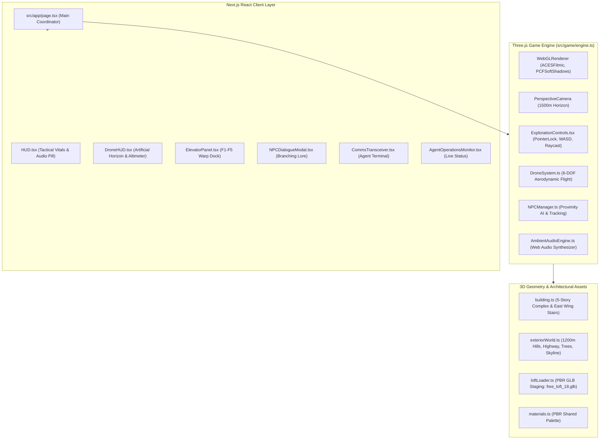

# 🏛️ Agents Map — Technical Architecture & Engine Specification

**Project:** `agents_map`  
**Core Technologies:** Next.js 14, React 18, Three.js (r169), TypeScript 5, Tailwind CSS v4, Web Audio API  
**Design Paradigm:** Autonomous Multi-Agent Agentic AI Collaboration  

---

## 1. System Overview & Component Diagram

---

## 2. Autonomous Multi-Agent Collaborative Loop

The `agents_map` project was engineered by four specialized agentic personas working in concert:

| Agent Persona | Role & Core Responsibility | Technical Output |
| :--- | :--- | :--- |
| **Agent Atlas** | *World Architect & Level Designer* | 5-story building layout, 40m footprint, 6m floor pitch, East Wing switchback stairs with dual-layer slope collider planes, panoramic window framing, and $1200\text{m}$ rolling terrain. |
| **Agent Neo** | *Gameplay & Systems Engineer* | WebGL render loop, First-Person exploration controls, PointerLock mouse look, 60 FPS physics tick, 6-DOF drone aerodynamics, and 1km geofence containment. |
| **Agent Iris** | *3D Interior Designer & Atmosphere* | Banishment of dark aesthetic in favor of natural daylight, Calacatta marble, honey-oak herringbone parquet, 10 resident NPCs with lore dossiers, and staging user GLB lofts. |
| **Agent Scribe** | *Technical Documentation & DevOps* | Architectural specifications, gameplay manuals, README, Git repository orchestration, and GitHub deployment pipelines. |

---

## 3. Core Engine & Rendering Pipeline (`src/game/engine.ts`)

* **WebGLRenderer Configuration**:
  * `powerPreference: 'high-performance'`, `antialias: true`.
  * Tone Mapping: `THREE.ACESFilmicToneMapping` with exposure tuned to `1.2`.
  * Pixel Ratio: Clamped to `Math.min(window.devicePixelRatio, 2.0)` to preserve 60+ FPS on Retina and 4K displays.
* **Atmospheric Sky & Distance Fog**:
  * Daytime sky color: `0x9bd0ea` (summer azure).
  * Aerial haze: `THREE.FogExp2(0xbfe0f2, 0.0016)` providing smooth blending between rolling hills, distant skyline, and sky dome.
  * Camera clipping planes: `near = 0.1m`, `far = 1500m` for expansive horizon vistas.
* **Cascaded Shadow Key Light**:
  * Sun Light: `THREE.DirectionalLight(0xfff3d6, 2.1)` angled from `(45, 75, 40)`.
  * Shadow Map: $2048 \times 2048$ resolution covering the entire $50\text{m} \times 50\text{m}$ complex envelope.
  * Sky Dome Fill: `THREE.HemisphereLight(0x87ceeb, 0x546e7a, 1.3)`.

---

## 4. Vertical Circulation & Slope Collider Matrix (`src/game/building.ts`)

* **East Wing Stairwell Core**: $X \in [12.0, 18.0]$, $Z \in [-6.0, 6.0]$ encased in panoramic glass curtain walls.
* **Dual-Layer Traverse Architecture**:
  * **Visual Layer**: Detailed metal step treads along switchback flights with mid-story landings at $\Delta Y = 3.0\text{m}$.
  * **Physics Layer**: Continuous invisible inclined ramp collider planes (`rampColliders`) angled at $\approx 31^\circ$. The downward ground raycaster locks camera altitude to the ramp plane, providing buttery-smooth ascent and descent without step-edge snagging.

---

## 5. Slow Roads Exterior World Generator (`src/game/exteriorWorld.ts`)

* **Procedural Rolling Hills**:
  * $1200\text{m} \times 1200\text{m}$ plane with $120 \times 120$ subdivisions.
  * Elevation computed via multi-harmonic sinusoidal wave synthesis:
    $$y(x, z) = \left[ 28 \sin(0.008x + 1.2)\cos(0.007z + 0.4) + 14 \sin(0.018x - 0.7)\sin(0.015z + 1.5) + 35 \cos(0.004x + 0.003z) \right] \cdot \text{blend}(d)$$
  * Footprint blending: flat within $50\text{m}$ radius of the building; smoothly blends to full hill height by $170\text{m}$.
* **Scenic Highway & Traffic Simulation**:
  * Catmull-Rom closed spline curve passing through 10 control points around the valley.
  * 18 cars and buses animated continuously along parallel lanes with forward-vector alignment and illuminated headlights/taillights.
* **Instanced Forest (420+ Trees)**:
  * Rendered via `THREE.InstancedMesh` with random scale ($0.75 - 1.45\times$) and rotation.
  * Multi-layer stylized canopies using flat-shaded dodecahedron geometries.

---

## 6. Apex-1 Recon Drone Flight Aerodynamics (`src/game/drone.ts`)

* **6-DOF Kinematic Model**:
  * **Pitch**: $\theta_x$ responds to <kbd>W</kbd>/<kbd>S</kbd> inputs with inertial damping.
  * **Roll Banking**: $\theta_z$ dynamically calculated based on lateral velocity and yaw rate:
    $$\text{targetRoll} = \left(-v_x \cos\psi - v_z \sin\psi\right) \cdot 0.035$$
  * **Yaw**: $\psi$ rotated smoothly via <kbd>Q</kbd>/<kbd>E</kbd> and horizontal mouse delta.
  * **Vertical Thrust**: <kbd>Space</kbd> (climb at $16\text{ m/s}$), <kbd>Ctrl</kbd> (descend at $16\text{ m/s}$).
  * **Turbo Boost**: <kbd>Shift</kbd> boosts maximum velocity from $18\text{ m/s}$ ($65\text{ km/h}$) to $38\text{ m/s}$ ($137\text{ km/h}$).
* **1km Geofence Containment**:
  * Radial distance clamped to $1000\text{m}$:
    $$\text{if } \sqrt{x^2 + z^2} > 1000\text{m} \implies \vec{p}_{x,z} = \hat{p}_{x,z} \cdot 1000\text{m}, \quad \vec{v} \leftarrow 0.5\vec{v}$$
  * Minimum altitude clamped to $4.0\text{m}$ above terrain; maximum altitude clamped to $280.0\text{m}$.

---

## 7. Procedural Web Audio Ambient Synthesizer (`src/game/audio.ts`)

* **Zero External Audio Assets**: 100% generated in real-time via the browser's Web Audio API `AudioContext`.
* **Harmonic Chords Progression**:
  * Cycles every 6 seconds through *Cmaj7*, *Am7*, *Fmaj7*, *Dm7*, and *G7sus*.
  * Multi-oscillator synthesis (sine + triangle waves with micro-detune chorus effect).
  * Filter sweep: dynamic lowpass filter with resonant $Q = 1.8$, modulated between $450\text{Hz}$ and $700\text{Hz}$.
* **Crystalline Pentatonic Chimes**:
  * Periodic random triggers across the C Lydian scale ($523\text{Hz} - 1174\text{Hz}$) with exponential decay envelopes.

---

## 8. GLB Loft Ingestion Pipeline (`src/game/loftLoader.ts`)

* **Asynchronous GLTFLoader**:
  * Ingests user models (`free_loft_18.glb`, `loft_16_interior.glb`, `interior_7.glb`) from `/public/models/`.
  * Computes exact 3D bounding boxes (`Box3`) and normalizes origin to `(0, 0, 0)` at floor level.
  * Scales models to fit $26\text{m} \times 26\text{m}$ interior rooms with $5.2\text{m}$ vertical clearance.
  * Traverses all 240+ child meshes, configuring `castShadow = true`, `receiveShadow = true`, and tuning PBR roughness and environment reflections.
